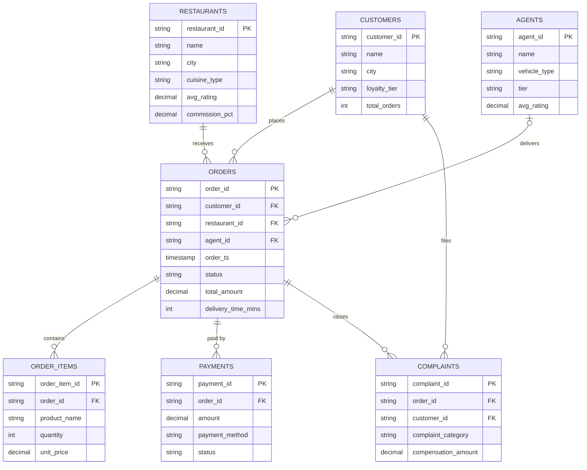
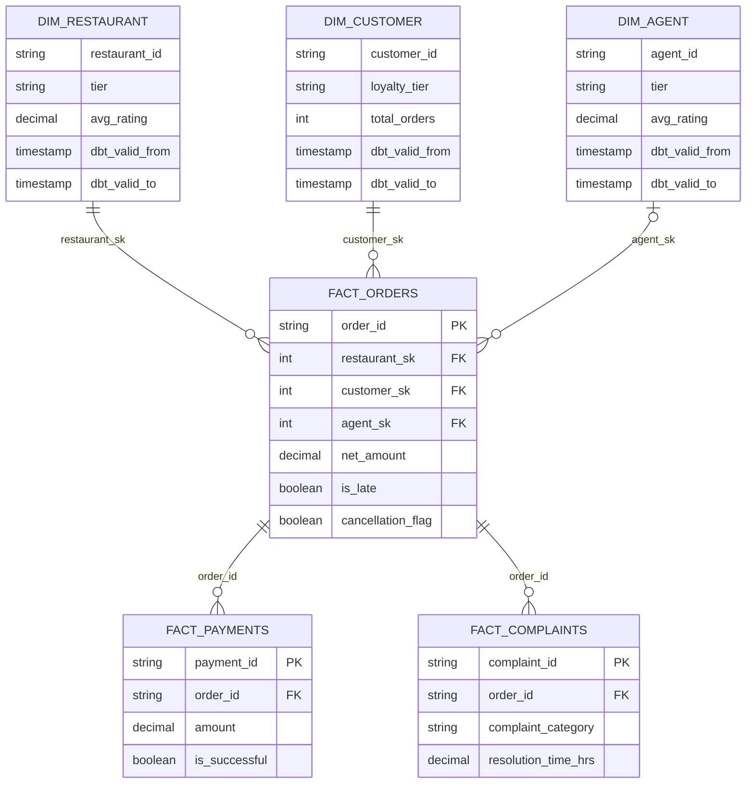
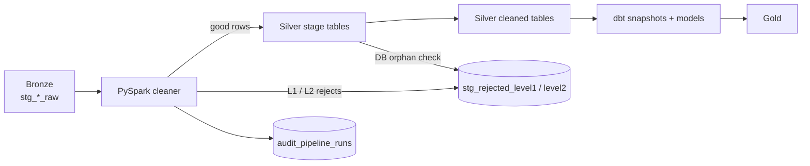

# ByteTrack — Restaurant & Delivery Intelligence Data Warehouse

> **A data warehouse that rejects 14.5% of its own data — on purpose — and accounts for every single row.**

An end-to-end data engineering pipeline for a Swiggy/Zomato-style food delivery platform, built with **PySpark, dbt, Apache Airflow, PostgreSQL and Docker**.

It pushes **1.1 million synthetic rows** (CSV + JSON) through a Medallion architecture (Bronze → Silver → Gold) with strict data-quality rules, SCD Type 2 dimensions, a two-level Dead Letter Queue, and an audit trail where **`Read = Good + Duplicates + Bad`** holds for every table.

> All data is synthetic, created by a custom generator (Faker) that injects controlled duplicates and bad records so the cleaning logic can be tested end to end.

---

## Project at a glance

| Metric | Value |
|---|---|
| Rows processed | **1,115,832** |
| Good (reached Silver) | **71.99%** |
| Duplicates | **13.49%** |
| Bad (sent to DLQ) | **14.52%** |
| Bronze / Silver | 7 staging tables / 7 cleaned tables + 2 DLQ tables |
| Gold | 3 SCD2 dimensions, 3 fact tables, 5 report tables |
| Airflow DAG | 7 tasks, ending with an automated reconciliation check |
| dbt | 14 models + 3 snapshots |

---

## Architecture

```
CSV + JSON  (7 raw files, ~1.1M rows)
        │
        ▼
BRONZE   7 staging tables, all text, no constraints
        │
        ▼
PySpark cleaning engine
   • primary-key deduplication
   • validation rules (nulls, ranges, formats, future dates, status values …)
   • standardisation (city / cuisine / vehicle fix maps, ID trim + upper-case)
   • orphan detection against parent tables
   • 2-level DLQ  (L1 structural · L2 business rule / orphan)
        │
        ▼
SILVER   7 cleaned tables  (PK / FK / CHECK constraints enforced)
        │
        ├─► dbt snapshot ─► GOLD  SCD2 dimensions  (restaurant, customer, agent)
        ├─► dbt run      ─► GOLD  fact tables      (orders, payments, complaints)
        └─► dbt run      ─► GOLD  report tables    (5 aggregates)
        │
        ▼
Airflow reconcile task  →  business queries
```

Orchestration (`dags/bytetrack_dag.py`):
`start → load_bronze → run_pyspark_cleaner → dbt_snapshot → dbt_run → reconcile → end`

---

## Data model (ER diagrams)

### Silver layer



### Gold layer (star schema with SCD2 dimensions)



Reference tables (`dim_date`, `dim_time`, `dim_payment_method`, `dim_order_status`, `dim_payment_status`, `dim_complaint_category`) sit alongside the star for lookups.

### Pipeline, DLQ and audit flow



---

## Final data-quality distribution

`Read = Good + Dupes + Bad` holds for every table, with **0 unaccounted rows**.

| Table | Read | Dupes | Good | Bad | Good % |
|---|---:|---:|---:|---:|---:|
| stg_restaurants_raw | 7,806 | 1,055 | 6,222 | 529 | 79.7% |
| stg_customers_raw | 156,088 | 21,087 | 124,357 | 10,644 | 79.7% |
| stg_agents_raw | 15,625 | 2,124 | 12,448 | 1,053 | 79.7% |
| stg_orders_raw | 312,064 | 42,063 | 218,911 | 51,090 | 70.2% |
| stg_order_items_raw | 312,197 | 42,196 | 220,956 | 49,045 | 70.8% |
| stg_payments_raw | 296,434 | 39,933 | 209,046 | 47,455 | 70.5% |
| stg_complaints_raw | 15,618 | 2,117 | 11,347 | 2,154 | 72.7% |
| **Total** | **1,115,832** | **150,575** | **803,287** | **161,970** | **71.99%** |

| Run | Good | Duplicates | Bad |
|---|---:|---:|---:|
| Early run (Run 49) | 33.34% | 13.32% | 53.34% |
| Final run | **71.99%** | **13.49%** | **14.52%** |

---

## Business questions answered

The Gold layer is modelled to answer 50+ business questions across eight areas. `queries.sql` has ready-to-run examples.

**Revenue and orders**
- Peak ordering hours
- Daily revenue trend (last 30 days)
- Monthly revenue and order growth
- Revenue by city, by cuisine and by zone
- Daily revenue by city and cuisine
- Average order value by city
- Discount given vs net revenue, by city
- Weekday vs weekend ordering patterns
- Order status distribution
- Cancellation rate by city
- Cancellation revenue impact by zone

**Restaurants**
- Top 10 restaurants by revenue
- Restaurants with the highest cancellation rate
- Revenue contribution by restaurant tier
- Commission revenue by month (from each restaurant's commission %)
- Rating vs revenue
- Average prep time vs late orders
- Cuisine popularity by city
- Active vs inactive restaurants

**Customers**
- Repeat vs one-time customers per month
- Top 10 customers by lifetime value
- Loyalty tier distribution
- Average order value by loyalty tier
- New customer sign-ups per month
- Customer retention by cohort
- Customers with the most cancellations
- **SCD2 history:** loyalty-tier changes over time
- Tier upgrade counts

**Delivery operations**
- Late-order % by cuisine and by zone
- Average delivery time by city
- Delivery time by hour of day
- Agent ranking by on-time rate
- Deliveries by vehicle type
- Agent performance by tier and rating
- Orders with no assigned agent

**Payments**
- Payment method distribution
- Success vs failure rate by method and by gateway
- Failed-payment revenue at risk
- Cashback given by method and month
- Daily payment volume trend

**Complaints**
- Complaint category breakdown
- Average resolution time by category
- Compensation paid by category
- Complaints per 1,000 orders by city
- Unresolved complaint backlog
- Complaints on late deliveries vs on-time deliveries

**Data quality (Dead Letter Queue)**
- DLQ summary by source table and rejection reason
- Top rejection reasons
- Level 1 vs Level 2 rejection split per table
- Rejection rate by table

**Pipeline health**
- Last 10 pipeline runs from the audit table
- Rows read vs inserted vs rejected per run

---

## Engineering problems and how I solved them

1. **Good-count mismatch.** Parent-ID caches were released too early, so payments and complaints skipped the orphan check; 161,544 rows counted Good, then vanished. Fix: keep caches, reclassify DB-caught orphans as Bad.
2. **Generator cascade.** Stacked error injections and ID gaps rejected most parents, orphaning children (33% Good). Fix: clean-pool generator, verified against an independent pandas check.
3. **Silent row loss.** pandas skipped ~2% of order lines with an extra schema-drift column, invisible to the audit. Fix: truncate drifted lines, log the count.
4. **SCD2 join fan-out.** Overlapping validity windows duplicated orders (220,632 facts vs 218,911 Silver), failing reconcile. Fix: non-overlapping, gap-free windows; one version per order.
5. **Key mismatches.** Lowercase and padded IDs landed under keys no child referenced, creating orphans. Fix: `upper(trim())` on every ID before deduplication and joins.
6. **Spark out-of-memory.** On a 3.7 GB Docker host the driver crashed on `order_items`. Fix: 1.5 GB driver, ID-only caches, released after last use.
7. **Rerun crash.** A failed upsert left duplicate keys in stage tables, causing `CardinalityViolation`. Fix: truncate stage tables before every write; runs are idempotent.
8. **JSONB write failures.** JDBC sent text into a JSONB column, so dead-letter writes failed. Fix: `stringtype=unspecified`, so Postgres casts payloads and rejected rows stay replayable.

---

## Key design features

- **Two-level Dead Letter Queue:** L1 structural rejects, L2 business-rule and orphan rejects, each stored as JSONB with the rejection reason.
- **Full auditability:** `audit_pipeline_runs` records read / inserted / rejected counts per table per run.
- **SCD Type 2** for restaurants, customers and agents (dbt snapshots, `check` strategy) with non-overlapping point-in-time joins.
- **Defence in depth:** Spark validation and orphan checks, a database orphan safety net, PK/FK constraints, and CHECK constraints on Silver.
- **Idempotent runs:** stage tables are emptied before each write.
- **Automated reconciliation:** the last Airflow task fails the run if the fact table exceeds Silver or Silver is empty.
- **Self-checking data generator:** prints the expected Read/Dupes/Good/Bad table so cleaner output can be compared directly.

---

## Tech stack

| Category | Tool |
|---|---|
| Languages | Python, SQL |
| Processing | PySpark 3.5 |
| Transformation | dbt-core 1.7.9 + dbt-postgres |
| Orchestration | Apache Airflow 2.9.0 |
| Database | PostgreSQL 15 |
| Infrastructure | Docker, Docker Compose |
| Test data | Faker |

---

## How to run

**Prerequisites:** Docker Desktop (at least 4 GB RAM allocated) and Git.

```bash
# 1. Clone and start the containers
git clone https://github.com/ChindaluruGanesh/bytetrack.git
cd bytetrack
docker compose up -d

# 2. Create the schema
docker compose exec -T postgres psql -U airflow -d airflow -f /docker-entrypoint-initdb.d/01_create_tables.sql

# 3. Generate synthetic data (prints the EXPECTED Read/Dupes/Good/Bad table)
docker compose exec airflow-scheduler python /opt/airflow/scripts/data_generator.py

# 4. Load Bronze
docker compose exec airflow-scheduler python /opt/airflow/scripts/load_bronze.py

# 5. Clean (Bronze -> Silver + DLQ); prints the FINAL DISTRIBUTION table
docker compose exec airflow-scheduler python /opt/airflow/scripts/pyspark_cleaner.py

# 6. Build Gold
docker compose exec airflow-scheduler bash -c "cd /opt/airflow/dbt/bytetrack_dbt && dbt snapshot --profiles-dir ."
docker compose exec airflow-scheduler bash -c "cd /opt/airflow/dbt/bytetrack_dbt && dbt run --profiles-dir ."
```

Or run everything from Airflow at **http://localhost:8080** (local demo login `airflow` / `airflow`): trigger the `bytetrack_pipeline` DAG, or

```bash
docker compose exec airflow-scheduler airflow dags trigger bytetrack_pipeline
```

Business queries:

```bash
Get-Content queries.sql -Raw | docker compose exec -T postgres psql -U airflow -d airflow
```

**Re-running from scratch:** truncate the Silver, DLQ and audit tables first, otherwise the previous run's results mix into the new counts.

---

## Repository structure

```
bytetrack/
├── docker-compose.yml
├── Dockerfile
├── README.md
├── queries.sql                  # business queries
├── dags/
│   └── bytetrack_dag.py         # Airflow orchestration
├── scripts/
│   ├── data_generator.py        # clean-pool synthetic data + expected results
│   ├── load_bronze.py           # CSV/JSON -> Bronze
│   └── pyspark_cleaner.py       # Bronze -> Silver + DLQ
├── dbt/bytetrack_dbt/
│   ├── models/                  # staging, facts, reports
│   └── snapshots/               # 3 SCD2 dimensions
└── sql/                         # DDL, static dimensions, audit, constraints
```

---

## What I learned

- Pipelines rarely fail on syntax; they fail through **silent data loss and numbers that quietly disagree**, so every layer reports counts that must add up.
- **Verify with SQL, not logs.** Comparing a logged number to a `COUNT(*)` exposed two of the bugs above.
- **Test data is part of the system.** Modelling the generator on paper, then checking it with an independent implementation, found problems faster than rerunning the pipeline.

---

## Author

**Chindaluru Ganesh** — [GitHub](https://github.com/ChindaluruGanesh)
